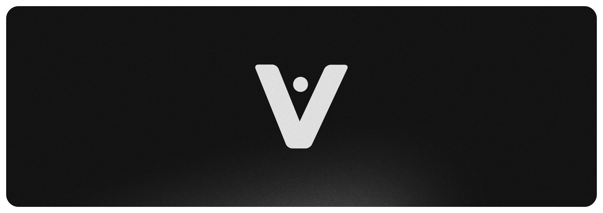
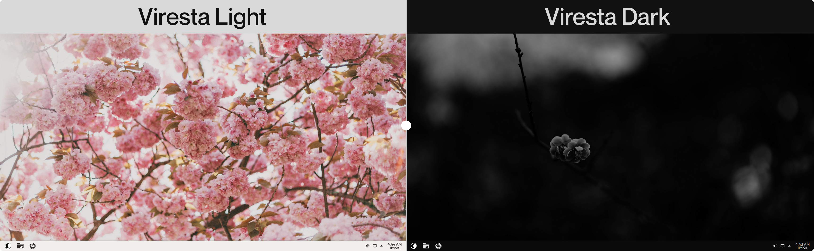

<h1 id="start-of-content" align="center">
  <a id="start-of-content" target="_blank"></a>
</h1>
<p align="center"><strong>The clean, stable and user-friendly KDE Plasma 6 dots for everyone!</strong></p>


<p align="center">
<a href="#-supported-distros">🐧 Supported distros</a> •
<a href="#-requirements">📋 Requirements</a> •
<a href="#-showcase">📸 Showcase</a> •
<a href="#-installation">📦 Installation</a> •
<a href="#-updating">🔄 Updating</a> •
<a href="#%EF%B8%8F-uninstalling">🗑️ Uninstalling</a> •
<a href="#-faq">❓ FAQ</a>
</p>

## 🐧 Supported distros
- Arch Linux
- CachyOS

## 📋 Requirements
- A minimal / no desktop installation of a [supported distro](#-supported-distros)
- A regular user with sudo privileges
- Git
- An active internet connection

## 📸 Showcase

<a target="_blank"></a>

## 📦 Installation

The installation script is designed for a minimal installation of a [supported distro](#-supported-distros). Make sure your system meets the requirements [above](#-requirements) before proceeding. Run the following commands as your regular user, not as root:

```sh
git clone https://github.com/QuintixLabs/Viresta.git
cd Viresta
./install.sh
```

## 🔄 Updating

To update, run this from anywhere:

```sh
viresta update
```

To only check whether a new release is out, without updating, add `--check`.

Viresta also shows a notification once when a new release is out, and nothing updates until you click **Update** or run `viresta update` yourself.

To stop these notifications, click **Don't show again** on one or just turn them off or back on with:

```sh
viresta update --notifications-off
viresta update --notifications-on
```

## 🗑️ Uninstalling

To uninstall, run this from anywhere:

```sh
viresta uninstall
```

`viresta` runs the scripts in the **Viresta** folder, so `./update.sh` and `./uninstall.sh` from there work the same. If you move the folder, run `./update.sh` from its new place once.

## ❓ FAQ

<details>
<summary>Why does Viresta exist?</summary>
<p></p>

I got tired of seeing so many Linux dotfiles that look good but are unstable, difficult to use, or constantly run into errors, so I decided to make something of my own, a clean, simple and stable KDE setup for Arch Linux that looks good, comes with different themes, includes useful applications and is actually made for everyday use

Ever wanted to set up **KDE** on **Arch** but didn't know how to rice your desktop, or maybe you just didn't feel like spending hours configuring everything yourself? That's what Viresta is here for, giving you a ready-to-use setup without having to figure everything out on your own

I wanted these dots to feel like a proper desktop you'd actually want to use every day, with the same kind of stability I currently have with my Windows setup running [AtlasOS](https://github.com/Atlas-OS/Atlas). I wanted to bring that same experience to Linux, creating something that is not just visually appealing, but also reliable, easy to use and ready for everyday tasks.
</details>

<details>
<summary>What does Viresta use?</summary>
<p></p>

- **Desktop:** KDE Plasma 6
- **Session:** Wayland
- **Login screen:** SDDM
</details>

<details>
<summary>Can I use it on a system that already has a desktop?</summary>
<p></p>

It's made for a minimal install, so that's the only setup it's tested on. If you already use KDE, Viresta replaces your KDE configs. It offers to back them up first, and uninstalling puts them back.
</details>

<details>
<summary>Does it install drivers?</summary>
<p></p>

Yes, for AMD, Intel and NVIDIA graphics, and the tools for VMware, QEMU/KVM and VirtualBox. The 32-bit versions come too, which Steam and Wine need. Very old NVIDIA cards stay on the `nouveau` driver. Drivers you already have are left alone. On CachyOS, Viresta leaves graphics drivers to CachyOS's own tool, [chwd](https://github.com/CachyOS/chwd).
</details>

<details>
<summary>Can I play games on it?</summary>
<p></p>

Yes. The **Gaming** option in the install menu, on by default, installs Steam, ProtonUp-Qt for more Proton versions, GOverlay, GameMode and MangoHud. To use GameMode and MangoHud in a Steam game, add this to its launch options:

```sh
gamemoderun mangohud %command%
```

If you already have Viresta, run `viresta install` and keep **Gaming** ticked. Updates never add it on their own.
</details>

<details>
<summary>The desktop doesn't start after installing NVIDIA drivers, what do I do?</summary>
<p></p>

Press `Ctrl+Alt+F2`, log in, and run these to go back to the `nouveau` driver:

```sh
sudo rm -f /etc/mkinitcpio.conf.d/10-viresta-nvidia.conf
sudo pacman -Rns $(pacman -Qq | grep nvidia)
sudo mkinitcpio -P
sudo reboot
```

Please open an issue too.
</details>

<details>
<summary>Will updating overwrite my changes?</summary>
<p></p>

No. `./update.sh` keeps your changes and adds the new ones around them. If an update changes a setting you also changed, your version is kept.
</details>

<details>
<summary>Can I go back to normal KDE?</summary>
<p></p>

Yes. `./uninstall.sh` removes Viresta and leaves you with plain KDE. It asks if you want to remove the apps too.
</details>

## 📄 License
[](http://www.gnu.org/licenses/gpl-3.0.en.html)

Viresta is [Free Software](https://en.wikipedia.org/wiki/Free_software): You can use, study, share and modify it at your will. The app can be redistributed and/or modified under the terms of the
[GNU General Public License version 3](https://www.gnu.org/licenses/gpl.html) published by the 
[Free Software Foundation](https://www.fsf.org/).

<div align="right">
<table><td>
<a href="#start-of-content">↥ Scroll to top</a>
</td></table>
</div>
